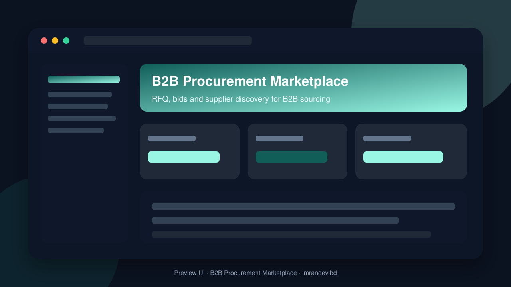
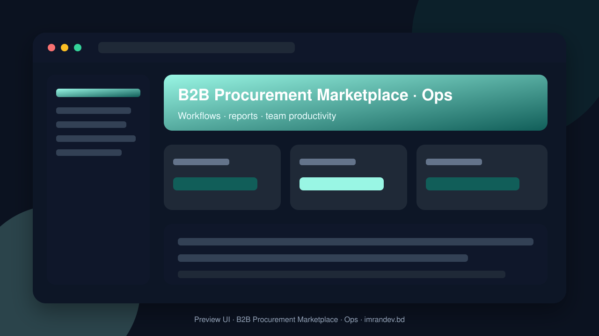

<p align="center">
  
</p>

# B2B Procurement Marketplace

<p align="center"><strong>RFQ, bids and supplier discovery for B2B sourcing</strong></p>

<p align="center">
  <a href="https://github.com/imranbru99/b2b-procurement-sourcing-marketplace-rfq"></a>
  
  
</p>

---

## Overview

**B2B Procurement Marketplace** — RFQ, bids and supplier discovery for B2B sourcing.

This README documents the **real application features** so GitHub and Google visitors can understand what the product does.

## Product screenshots

| Dashboard | Operations |
| :---: | :---: |
|  |  |

## Application features

### B2B sourcing marketplace

- Buyer RFQ publishing
- Supplier discovery and profiles
- Competitive bidding / quote submission
- Bid comparison and award workflow
- Category and industry sourcing directories
- Messaging between buyers and suppliers
- Document exchange for specs and compliance
- Marketplace admin moderation tools

### Implemented application modules

- Contracts
- Core
- Intelligence
- Marketplace
- Operations
- Orders
- Platform
- Sourcing
- Suppliers

### Domain data models

- Contact Message
- Module
- Organization
- Organization Module
- Organization User

## Tech stack

- PHP 8.2+ / Laravel
- Filament admin (where enabled)
- Migrations, seeders, queues
- Vite asset pipeline
- MySQL / SQLite ready

## Quick start

```bash
git clone https://github.com/imranbru99/b2b-procurement-sourcing-marketplace-rfq.git
cd b2b-procurement-sourcing-marketplace-rfq
composer install
cp .env.example .env
php artisan key:generate
php artisan migrate --seed
npm install && npm run build
php artisan serve
```

## Author

**Imran Ahmed** · https://imrandev.bd · me@imrandev.bd  
GitHub: https://github.com/imranbru99/b2b-procurement-sourcing-marketplace-rfq

---
## 🤝 Let's Connect & Collaborate

I am open to **Senior Remote Full-Stack Roles**, AI Platform Architecture Contracts, and Enterprise Technical Advisory.

| Channel | Link |
| :--- | :--- |
| Portfolio | https://imrandev.bd |
| GitHub | https://github.com/imranbru99 |
| LinkedIn | https://linkedin.com/in/imranbru99 |
| Email | me@imrandev.bd |
| WhatsApp | https://wa.me/8801576918420 |
| Packagist | https://packagist.org/packages/imrandevbd/ |

